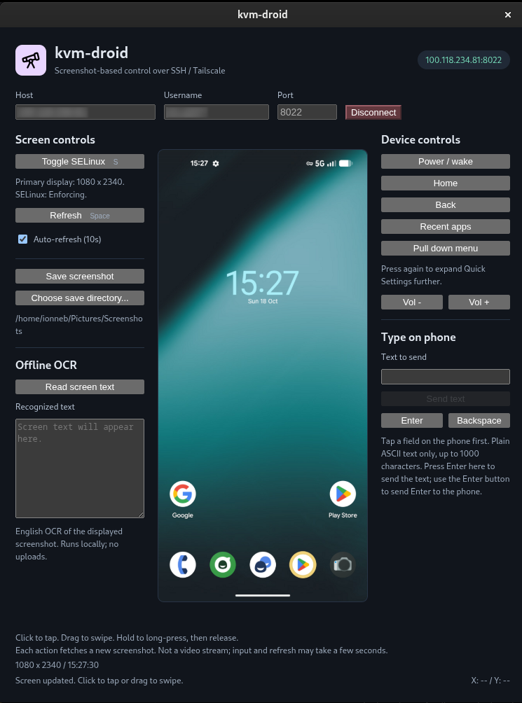

# kvm-droid

A desktop app to interact remotely with your rooted Android device.

No USB cable required!

## Feature requests

To provide feedback on this app, please open an [issue](https://github.com/rxsystms/kvm-droid/issues) here on github. We read all issues!

## Downloads

Get the latest release here: https://github.com/rxsystms/kvm-droid/releases

## Screenshots

## Features

- Streaming screenshots with manual or automatic refresh
- Remote control of your Android over ssh/Tailscale
- Linux, macOS, and Windows desktop apps
- Existing SSH keys and host verification
- Adaptive portrait and landscape display
- Tap, swipe, and long-press gestures
- Home, Back, Recents, power, and volume controls
- Notification shade and Quick Settings access
- Plain-text typing, Enter, and Backspace
- Timestamped PNG screenshot saving
- Folder picker with remembered save location
- Offline English OCR with selectable text
- Phone-pixel coordinate readout
- Display-size and SELinux status
- Confirmed SELinux mode switching
- Keyboard shortcuts for refresh and SELinux
- Disconnect and reconnect controls
- Explicit errors and automatic-refresh pause
- No Android companion app required

"live" (high latency) images of the phone are captured and streamed over SSH into memory. No screenshot files are written on the phone. Screenshots are only saved on the computer when you click **Save screenshot**.

**Save screenshot** saves the currently displayed frame as a PNG in `~/Pictures/Screenshots` by default (your home directory on the computer, not the phone). **Choose save directory...** opens a native folder picker; the choice is remembered across app restarts. The directory is created when saving if needed. Filenames include the frame's capture timestamp in UTC, for example `Screenshot-2026-10-18T13-55-55-405Z.png`. Repeated saves never overwrite existing files. Saving does not refresh the screen or send input to the phone; refresh first if you need a newer image. The saved path or any error appears in the footer.

The screen frame follows the screenshot's aspect ratio, fitting the available window space without a square background or stretching. It adapts when the window is resized or the phone rotates.

Clicks on the screenshot rendered in the Electron app are transmited to the remote device as taps at a specific coordinate. The screenshot response is then sent and re-rendered in Electron.

A new screenshot is requested automatically 10 seconds after the previous request completes. Pressing space requests a new screenshot immediately (unless a form field or button has focus). Automatic refresh can be turned off; it pauses after an error until re-enabled.

Click the screenshot to tap, drag to swipe, or hold for at least half a second and release to send a long press. Coordinates are mapped to the screenshot's original resolution, including landscape screenshots. Gestures are sent on release and are capped at two seconds. Releasing outside the image cancels the gesture.

Move the pointer over the screenshot to see **X / Y** in the bottom-right footer. These are zero-based phone-screen pixel coordinates, using the same scaling as tap input, not desktop/window coordinates. The readout clears when you leave the image, resize, refresh, disconnect, or switch away from the app. Moving the pointer does not send input to the phone.

On each connection, the primary display size (single screen only) is checked using `wm size`. Physical size, any override size, and SELinux state are shown beside the screen. Touch coordinates continue to use each screenshot's actual dimensions to handle rotation.

Click **Pull down menu** to swipe down from the top edge and open the notification shade. Click it again to expand Quick Settings further. Each click sends one 300ms swipe and refreshes the screenshot. On the supplied 1080x2340 device this uses `input swipe 500 0 500 900 300`; coordinates scale with the current screenshot size on other displays.

Hardware buttons home, power/wake, back, recent apps, and volume are supported.

**Offline OCR**, below the screenshot-saving controls on the left, reads English text from the currently displayed screenshot. Click **Read screen text** to populate the selectable, read-only text box. Recognition runs locally using bundled Tesseract.js, WebAssembly, and English language data: no online service, runtime downloads, or separate Tesseract installation is required. Refresh first for a newer screen. OCR pauses automatic refresh while running, reports errors or no text explicitly, and may misread small or stylized text. Results stay in memory and clear on connect/disconnect; the capture time is shown with the result.

Screen controls (SELinux, display information, refresh, auto-refresh, and screenshot saving/directory selection) are on the left of the screenshot. Hardware buttons and the pull-down menu remain on the right. Both panels scroll independently when space is limited.

Press **S** or click **Toggle SELinux** to switch between Enforcing and Permissive after connecting. Switching to Permissive requires confirmation because it reduces protection across the entire device. Switching back to Enforcing does not require confirmation. Shortcuts do not trigger while a form field or button has focus. The current state is checked before every toggle and verified after a change; devices reporting Disabled cannot be toggled with `setenforce`. This changes runtime policy, not boot configuration; closing the app does not restore the previous state.

**Type on phone**, on the right, sends text to the phone's focused field. Tap an editable field in the screenshot first, type or paste in **Text to send**, then click **Send text** or press Enter in that box. Supports one line of 1-1000 printable ASCII characters, including spaces and punctuation; accented letters, emoji, tabs and newlines are not supported. Separate **Enter** and **Backspace** buttons send those keys to the phone. The soft keyboard need not be visible. Sending refreshes the screenshot and clears the box on success; errors retain your text, but input may already have reached the phone, so check before retrying. Text is not saved in app settings.

## License

This project is licensed under the [PolyForm Noncommercial License 1.0.0](./LICENSE.md). It is source-available, not open source under the OSI definition. Noncommercial use is permitted under the license; commercial use is not permitted unless separately licensed by the copyright holder. Contact the repository owner to request a paid commercial license.

### run

This desktop app runs on:
- Mac
- Linux
- Windows

Device should be accessible remotely via [Tailscale](https://tailscale.com).

Ordinarily, the device should be rooted.

Requirements: Node.js 22.12 or newer, npm, a desktop session, and the OpenSSH `ssh` client on your computer. Tailscale must be connected and the rooted Android device's Termux SSH server must be running.

Desktop targets: **Linux, macOS and Windows**. Packaged apps include Electron and do not require Node.js or npm; OpenSSH and Tailscale are still required.

- **Linux:** install the OpenSSH client using your distribution's package manager. AppImages may require FUSE (`libfuse2` / `libfuse2t64`) or can be run with `--appimage-extract-and-run`.
- **macOS:** the app uses the system `/usr/bin/ssh`, including when launched from Finder. It keeps the standard application/Edit/Window menus and macOS close/reopen behavior.
- **Windows:** enable **OpenSSH Client** in Settings > Optional features, verify `ssh -V` works in PowerShell, and restart the app after installation. The app uses `ssh.exe` from PATH without a shell or visible console windows. Keys and known hosts normally live in `%USERPROFILE%\.ssh`.

On Linux, startup registers `kvm-droid.desktop` and a copy of the purple icon in your user XDG data directory (normally `~/.local/share`). The desktop ID, X11 window class and Wayland app ID use `kvm-droid`, allowing GNOME's Super-key overview and dock to find the correct icon, including during `npm start`. No root access is needed. The launcher follows the most recently started development/unpacked/AppImage location; start the app again if you move it. Close older windows and reopen after an upgrade; an old Android Remote or generic Electron favorite may need to be unpinned and replaced with **kvm-droid**.
